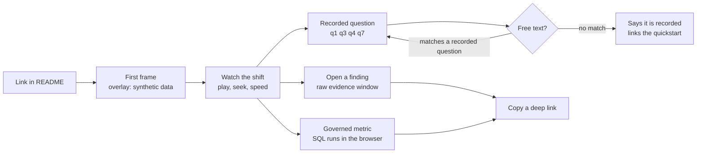

# PRD: hosted browser replay demo (E1)

Status: draft for review, written 2026-10-13. Target release: v0.3.0, the close of phase P2.
Roadmap entry: E1, work package WP-P2-12, gate `VAL-GATE-E1-001`.
Implementation contract: [Dashboard and replay](../design/dashboard-replay.md), sections 4.4, 5.10 and 5.11.

This page says what E1 is for, who it serves, and how we will know it worked. The design
specification says how it is built, and this page does not restate it.

## 1. Summary

E1 records one simulated shift (telemetry, findings, and an agent transcript) and publishes a
static viewer for it on GitHub Pages. A reader opens a link and watches the line run, alarms
fire, and the agent answer questions, with no install, no container, and no account.

The viewer is the live dashboard's single HTML file, loading a recorded bundle. The reader can also run governed metric queries in the browser against the recorded run, with the SQL shown beside the number.

## 2. Problem and evidence

twinflow is designed in full and built from the bottom up. The README says so: it is "a plan
with published evidence rules, not a shipped product." A reader who arrives today has prose,
a diagram, and unfilled metric markers, and has nothing to watch.

The evidence is in the repository, because the project has no analytics and no users yet.

- [ROADMAP.md](https://github.com/ragonxdragon/twinflow/blob/main/ROADMAP.md), "Change 2: E1 moves to the close of P2", records the reasoning: most people who judge the repository will never run Docker, and E1 is what lets them see the system work.
- The quickstart in the README is marked planned. Gate `VAL-GATE-QS-001` holds the first path to under 300 seconds, which is still a download, a build, and a terminal.
- The README states that no replay URL is linked until the URL serves a page. Today that link does not exist.

## 3. Users and jobs to be done

| User                         | Job to be done                                                                                   | What they need from E1                                                         |
| ---------------------------- | ------------------------------------------------------------------------------------------------ | ------------------------------------------------------------------------------ |
| Evaluator                    | Decide in a few minutes whether this project is real engineering, before reading any code        | A first frame fast, a guided first run, and evidence that numbers are executed |
| Operations or quality reader | See what a flood of alarms, a bottleneck, and a what-if verdict look like on a line              | The recorded questions q1, q3, q4 and q7 playable from deep links              |
| Prospective adopter          | Judge whether the replay format and viewer are worth taking alone as the `twinflow-replay` brick | A documented bundle format and a bundle that `check` can verify                |
| Maintainer                   | Keep a public demo that never goes stale or ungrounded                                           | Re-recording at every tag, gated                                               |

## 4. Goals and non-goals

Goals:

1. A reader reaches a rendered first frame from the link alone.
2. Every number a reader sees was computed by the system, either recorded from the seeded run or executed in the browser against it.
3. The demo is reproducible by a stranger from a clone, with no model and no key.

Non-goals for E1:

- No live model inside the page and no reader-supplied key. `M-REPLAY-BYOK` is sequenced after E1 because it changes the security posture of a static page.
- No download of the raw device stream through the viewer. `M-REPLAY-FULLTAP` carries the full tap as a release artifact, at P3.
- No analytics, cookies, or telemetry from the page.
- No claim that the data is about a real facility. All data is synthetic, and the page says so.

## 5. Success metrics

Each value below is a metric marker. Nothing here has been measured, so each reads TBD, and
`metric-marker-gate.sh` fails the v0.3.0 release if one still does. A marker is filled only
from a recorded run, with its seed and commit.

| Metric                       | Definition                                                                                                                                              | Measured by                                                                                          | Value                                                                     |
| ---------------------------- | ------------------------------------------------------------------------------------------------------------------------------------------------------- | ---------------------------------------------------------------------------------------------------- | ------------------------------------------------------------------------- |
| Time to first frame          | Seconds from navigation start to the first rendered view-model frame, median over repeated loads                                                        | The `BG-LOAD-1` harness on the deployed Pages build, under 4x CPU throttling                         | <!--METRIC:replay_first_frame_seconds@v0.3.0-->TBD<!--/METRIC-->          |
| Bundle size                  | Gzipped bytes of the full-length bundle, summed over chunks, keyframes, media, and manifest                                                             | Written to the manifest by `record` at the end of the run (`BG-BUNDLE-1`)                            | <!--METRIC:replay_bundle_gz_bytes@v0.3.0-->TBD<!--/METRIC-->              |
| Unaided task success         | Share of first-time test participants who, without help, find the current bottleneck, open the evidence behind one finding, and run one governed metric | Moderated sessions against the deployed page, script and tally committed under `artifacts/measured/` | <!--METRIC:replay_task_success_rate@v0.3.0-->TBD<!--/METRIC-->            |
| In-browser query parity      | Share of exposed governed metrics where the number the browser renders equals the Python metric layer's value over the same Parquet files               | `T-QUERY-1`, extended to loop over every exposed metric                                              | <!--METRIC:replay_query_parity_rate@v0.3.0-->TBD<!--/METRIC-->            |
| Ungrounded numeric sentences | Count of numeric sentences in the published transcript with no logged query result ID                                                                   | The E26(f) grounding checker run over the recorded transcript, as `VAL-GATE-E1-001` requires         | <!--METRIC:replay_ungrounded_numeric_sentences@v0.3.0-->TBD<!--/METRIC--> |

The gate budgets behind these metrics are configuration values from the design specification, not results. They are 3 s to first frame under 4x CPU throttling (`BG-LOAD-1`), 25 MiB gzipped for an 8-hour mid-market shift (`BG-BUNDLE-1`), and 1.2 MB of first-paint payload (`BG-FIRSTPAINT-1`).

## 6. Requirements

Priority uses MoSCoW: M must ship in v0.3.0, S should.

### 6.1 Functional

| Id    | Requirement                                                                                                                                                              | Priority |
| ----- | ------------------------------------------------------------------------------------------------------------------------------------------------------------------------ | -------- |
| FR-1  | `twinflow replay record` runs a seeded shift in simulation mode and writes a bundle that follows `replay.manifest.v1`                                                    | M        |
| FR-2  | `replay check` verifies every chunk hash and the manifest counts, and the viewer shows a tamper warning on a hash mismatch                                               | M        |
| FR-3  | `replay publish` produces the site tree, with the dashboard file, the bundle, a dataset card, and a provenance file                                                      | M        |
| FR-4  | The viewer loads in replay mode from the same file as the live dashboard, renders the first frame before the whole bundle arrives                                        | M        |
| FR-5  | Play, pause, speed, and seek work across the whole shift, with a seek costing one keyframe and at most one chunk                                                         | M        |
| FR-6  | Deep links open a sim time, a finding, a recorded question, or a filtered panel                                                                                          | M        |
| FR-7  | The agent panel lists the recorded questions (q1, q3, q4, q7 at v0.3.0), plays the recorded turn with its tool trace, and states plainly that the transcript is recorded | M        |
| FR-8  | Free text either matches a recorded question and says which, or says the demo is recorded and links the quickstart. It never invents an answer                           | M        |
| FR-9  | `M-REPLAY-QUERY`: the reader picks a governed metric, the browser runs the SQL on the recorded Parquet files, and the page shows the SQL beside the result               | M        |
| FR-10 | A first-run overlay states that the data is synthetic and names what to click, and it is keyboard reachable                                                              | S        |
| FR-11 | The README links the demo within the first three non-empty lines after the H1 (`T-README-1`)                                                                             | M        |

### 6.2 Non-functional

| Id    | Requirement                                                                                                                                                   | Priority |
| ----- | ------------------------------------------------------------------------------------------------------------------------------------------------------------- | -------- |
| NFR-1 | Two `record` runs at the same seed, config, version, and a complete cassette produce byte-identical bundles on the pinned runner (`BG-DET-UI-1`, C1)          | M        |
| NFR-2 | `record` resolves every agent turn from a committed cassette and fails on a miss. It never falls back to a live model call                                    | M        |
| NFR-3 | Zero third-party origins and a strict content security policy (`BG-CSP-1`). The query engine is vendored, pinned, and loaded lazily                           | M        |
| NFR-4 | Accessibility meets `VAL-GATE-A11Y-001`: no critical or serious axe violations, keyboard completion, severity by shape and text, reduced motion honored (C12) | M        |
| NFR-5 | The bundle is a build artifact and is not committed. `just demo-bundle` rebuilds it with no model and no key                                                  | M        |
| NFR-6 | The page holds no secret and sends nothing back to a server                                                                                                   | M        |

## 7. UX and flow

The first script has four beats. Find the constraint (q1), survive the alarm flood (q3), run the experiment and read the verdict (q4), and watch the agent refuse a question no tool covers (q7). The refusal is deliberate. A reader who tests the boundary finds a system
that admits it.

## 8. Dependencies on existing milestones

| Dependency             | Why E1 needs it                                                                                                     |
| ---------------------- | ------------------------------------------------------------------------------------------------------------------- |
| P1                     | The recorded event log, the walking skeleton, and the stub dashboard that E1 turns into the viewer                  |
| P2                     | The findings stream, `run_whatif`, and the bottleneck work that give the shift something worth watching             |
| E3                     | Sparkplug B payloads, because rule R02 places the wire format ahead of the first recorded bundle                    |
| E4a                    | Event-sourced replay, the basis for recording and seeking                                                           |
| E26(a), E26(c), E26(f) | Rule R06: a public transcript with an ungrounded number is the failure the accuracy stack exists to prevent         |
| E26(b)                 | The governed metrics layer behind `M-REPLAY-QUERY`, placed in P0 by rule R04                                        |
| C1, C3                 | Determinism for byte-identical bundles, and the schema registry for the manifest and frame contracts                |
| C7                     | SECURITY.md covers the posture of a published static page                                                           |
| C11, C12               | The SBOM entry for the vendored query engine, and the accessibility baseline                                        |
| `VAL-GATE-E1-001`      | Re-records the bundle at every tag from v0.3.0, loads it in the viewer, and runs the transcript through the checker |
| `VAL-GATE-A11Y-001`    | Accessibility conditions on the viewer                                                                              |

Sequenced after E1, not dropped: `M-REPLAY-FULLTAP` at P3, questions q2 and q6 at P3, q5 at
P3b, and `M-REPLAY-BYOK` as a P6 follow-on.

## 9. Risks and mitigations

| Risk                                                       | Mitigation                                                                                                                  |
| ---------------------------------------------------------- | --------------------------------------------------------------------------------------------------------------------------- |
| The bundle outgrows the size budget as subsystems land     | `BG-BUNDLE-1` measures it on every record, with a per-chunk breakdown, so the build reports growth before a reader feels it |
| The public demo goes stale between tags                    | `VAL-GATE-E1-001` re-records at every tag, and a nightly path catches a broken long run within a day                        |
| A recorded transcript carries an ungrounded number         | The grounding checker gates publication, and the transcript comes from a cassette that is reviewed like source              |
| A reader reads the transcript as a live model              | The agent panel says it is recorded, free text never fabricates, and `M-REPLAY-QUERY` supplies real execution               |
| The vendored query engine is a development build or drifts | Pin a chosen version with a file hash in the SBOM, and never float on `latest`                                              |

## 10. Rollout and acceptance criteria

Rollout follows the schedule in the design specification. Every push to `main` records a short
smoke bundle and runs the accessibility and policy gates on the built site. Every tag and a
nightly path record the full-length bundle. The README link is added at the commit that first
serves a page, and not before.

E1 is accepted when all of these hold on the v0.3.0 candidate:

1. `VAL-GATE-E1-001` passes: the bundle is re-recorded from the tag's code, the viewer loads it, and the transcript passes the grounding checker.
2. `VAL-GATE-A11Y-001` passes on the deployed build.
3. Two `record` runs at the same seed are byte-identical on the pinned runner.
4. `T-QUERY-1` and `T-README-1` pass, and the shipped script q1, q3, q4, q7 plays end to end by keyboard alone.
5. Every marker in section 5 holds a value from a recorded run, with its seed and commit, or the release does not ship.
6. `just demo-bundle` rebuilds the bundle from a clean clone with no model and no key.

## 11. Open questions

1. Does "the agent answers questions in the browser" mean a recorded transcript plus in-browser SQL, as this PRD assumes? A live model inside the page would change the security posture of the whole demo (OQ-3 in the design specification).
2. Is a bundle also attached to each release tag, which adds tens of megabytes per release to the history, or is `just demo-bundle` enough (OQ-7)?
3. What is the test script, participant count, and time limit for the unaided task success metric? The count and limit are unset and are not guessed here.
4. Which of the candidate headline numbers goes in the first three README lines beside the link (OQ-2)?
